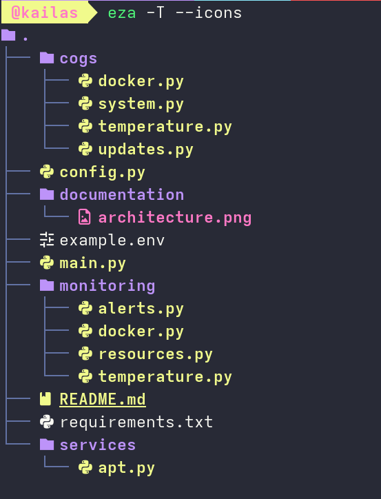

## Argus — Server Monitoring Discord Bot

### it is Highly recommended to run the program as a separate user without root,sudo,...  groups added. 

### Architecture


## Commands

| Command | Description |
|---|---|
| `/update` | Checks for system updates |
| `/uptime` | Shows the current uptime |
| `/ping` | Shows latency |
| `/status` | Shows general system information |
| `/processes` | Lists processes according to CPU/Memory load |
| `/temperature` | Shows the system temperature |
| `/containers` | List all docker containers and their states |
| `/docker` | Show docker daemon and container summary |
| `/container_info {parameter}` | show details for one container |
| `/docker_stats` | Shows live resource usage of runnign containers |


## APT Update Service

`apt.py` checks the system for updates using `apt-get update`, implemented using `sudo -n`.

Therefore, edit `visudo`:

```sudoers
user ALL=(root) NOPASSWD: /usr/bin/apt-get update
```

## Setting Up a Safe Docker Environment for Container Monitoring

### Deploy a Read-Only Docker Socket Proxy

`compose.yaml` configuration to set up the read-only Docker socket proxy

```yaml
services:
  socket-proxy:
    image: lscr.io/linuxserver/socket-proxy:latest
    container_name: socket-proxy
    environment:
      - CONTAINERS=1   
      - INFO=1        
      - VERSION=1      
      - POST=0        
    volumes:
      - /var/run/docker.sock:/var/run/docker.sock:ro
    ports:
      - 127.0.0.1:2375:2375 
    restart: unless-stopped
```

### Change the Client Daemon Endpoint for Restricted User

Inside your `~/.bashrc` or `~/.profile` file add:

```bash
export DOCKER_HOST="tcp://127.0.0.1:2375"
```
