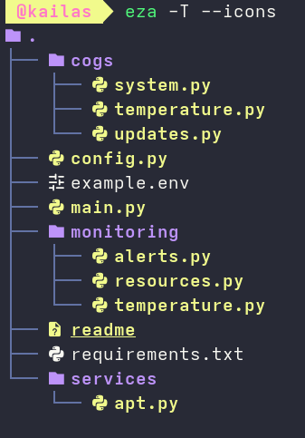

# Argus — Server Maintenance Discord Bot

Argus is a Server Maintenance Discord Bot.



## Commands

| Command | Description |
|---|---|
| `/update` | Checks for system updates |
| `/uptime` | Shows the current uptime |
| `/ping` | Shows latency |
| `/status` | Shows general system information |
| `/processes` | Lists processes according to CPU/Memory load |
| `/temperature` | Shows the system temperature |

## APT Update Service

`apt.py` checks the system for updates using `apt-get update`, implemented using `sudo -n`.

Therefore, edit `visudo`:

```sudoers
user ALL=(root) NOPASSWD: /usr/bin/apt-get update
```

